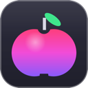

### Hallo, ich bin jeremdevgit 👋

<a href="README.md">English</a> · <a href="README.fr.md">Français</a> · <a href="README.es.md">Español</a> · <b>Deutsch</b> · <a href="README.it.md">Italiano</a> · <a href="README.pt.md">Português</a> · <a href="README.zh.md">简体中文</a> · <a href="README.ja.md">日本語</a>

Ich entwickle **freie, kostenlose und werbefreie Software** für Windows, macOS, Linux und den Browser. Keine Telemetrie, kein Konto für lokale Funktionen; die optionale Synchronisierung spricht nur mit dem Dienst deiner Wahl. Alle Apps gibt es in **8 Sprachen**.

#### 🛠️ System & Hardware

| | App | System | Wofür | Holen |
|:-:|---|---|---|---|
|  | **[Boîte à outils](https://github.com/jeremdevgit/boite-a-outils)** | Windows · macOS | Den Computer pflegen, ohne etwas kaputt zu machen: Bereinigung, Autostart, Hardware, Sensoren, Dateisuche – alles rückgängig machbar. | [Download](https://github.com/jeremdevgit/boite-a-outils/releases/latest) |
|  | **[rJb](https://github.com/jeremdevgit/rjb)** | Windows | RGB-Beleuchtung für alle Peripheriegeräte und Komponenten in einer einzigen schlanken App. | [Download](https://github.com/jeremdevgit/rjb/releases/latest) |
|  | **[LJ Hub](https://github.com/jeremdevgit/lj-hub)** Frühe Alpha | Windows · macOS · Linux | Lokale Profile und Inventar für Logitech-Geräte, mit experimenteller DPI- und Abfrageraten-Steuerung. | [Download](https://github.com/jeremdevgit/lj-hub/releases) |
|  | **[Decklight](https://github.com/jeremdevgit/decklight)** Vorschau | Windows · macOS · Linux | Ein schlankes virtuelles Stream Deck, das unterstützte USB-Modelle steuert und Stream-Deck-Profile importiert. | [Download](https://github.com/jeremdevgit/decklight/releases) |

#### 📒 Produktivität & Daten

| | App | System | Wofür | Holen |
|:-:|---|---|---|---|
|  | **[Carnet de notes](https://github.com/jeremdevgit/carnet-rust)** | Windows | Verschlüsselte Notizbücher für Windows mit Markdown, Aufgaben, Verlauf und experimenteller Nextcloud-, WebDAV- und Joplin-Synchronisierung. | [Download](https://github.com/jeremdevgit/carnet-rust/releases/latest) |
|  | **[JMeca](https://github.com/jeremdevgit/jmeca)** Beta | Windows · macOS · Linux | Eine verschlüsselte Garage für alle Fahrzeuge: Wartung, Erinnerungen, Serviceheft, Kraftstoff und Kosten. | [Download](https://github.com/jeremdevgit/jmeca/releases) |
|  | **[Suite Libre](https://github.com/jeremdevgit/suite-libre)** | Browser | Sechs Alltagswerkzeuge im Browser, ohne Konto und ohne Tracking: QR-Codes, Verpixeln, Fotos, Umrechnungen, Noten, Passwörter. | [Öffnen](https://jeremdevgit.github.io/suite-libre/) |

#### 🎮 Musik & Spiele

| | App | System | Wofür | Holen |
|:-:|---|---|---|---|
|  | **[Pomme](https://github.com/jeremdevgit/pomme)** | Windows | Ein schlanker Musikplayer für Apple Music und lokale Audiodateien: Songtexte, Equalizer, Miniplayer. | [Download](https://github.com/jeremdevgit/pomme/releases/latest) |
|  | **[Ludothèque](https://github.com/jeremdevgit/ludotheque)** | macOS | Alle Spiele an einem Ort auf dem Mac: Steam, Epic, GOG, Xbox, PlayStation, Nintendo, Emulatoren und mehr. | [Download](https://github.com/jeremdevgit/ludotheque/releases/latest) |
|  | **[AutoDex](https://github.com/jeremdevgit/autodex)** | Windows · macOS · Linux · Smartphones (Web) | Entdecken, fotografieren, sammeln: ein Autosammelspiel mit Bilderkennung direkt auf dem Gerät. | [Download](https://github.com/jeremdevgit/autodex/releases/latest) |
|  | **[Batailles de France](https://github.com/jeremdevgit/batailles-de-france)** | Browser | Echtzeitstrategie im Browser auf den Karten von Lyon, Paris, Marseille, Bordeaux und Straßburg. | [Download](https://github.com/jeremdevgit/batailles-de-france/releases/latest) |

Jede Version enthält SHA-256-Prüfsummen; Installer aktualisieren die vorherige Version. Ideen oder Fehler: Issue im Repository der App öffnen. Sicherheitslücken: bitte privat melden (Tab **Security**).
