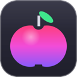

### ¡Hola! 👋

[English](README.md) · [Français](README.fr.md) · **Español**

Creo programas **libres, gratuitos y sin publicidad** para Windows, macOS y el navegador. Sin telemetría. Las funciones locales no requieren cuenta; la sincronización opcional envía los datos elegidos al servicio configurado.

🌐 **Disponibles en 8 idiomas**: español, inglés, francés, alemán, italiano, portugués, chino y japonés. Cada programa sigue el idioma del sistema y permite cambiarlo en sus ajustes.

| | Programa | Para | En breve | Idiomas | Instalar |
|:-:|---|---|---|---|---|
|  | **[JMeca](https://github.com/jeremdevgit/jmeca)** | Windows · macOS · Linux | Garaje cifrado: vehículos, clientes, recordatorios, historial y combustible. | 🌐 8 idiomas | [Descargar](https://github.com/jeremdevgit/jmeca/releases/tag/v0.1.1-beta.2) |
|  | **[Carnet de notes](https://github.com/jeremdevgit/carnet-rust)** | Windows | Notas locales cifradas, interfaz inspirada en Liquid Glass y sincronización Joplin/Nextcloud experimental. | 🌐 8 idiomas | [Descargar ZIP](https://github.com/jeremdevgit/carnet-rust/releases/latest) |
|  | **[Boîte à outils](https://github.com/jeremdevgit/boite-a-outils)** | Windows · macOS | Cuida tu ordenador sin romper nada: inicio, limpieza, ajustes ocultos, hardware, sensores, historial reversible. | 🌐 8 idiomas | [Descargar](https://github.com/jeremdevgit/boite-a-outils/releases/latest) |
|  | **[Pomme](https://github.com/jeremdevgit/pomme)** | Windows | Reproductor ligero para Apple Music y archivos de audio locales: letras, ecualizador, minirreproductor. | 🌐 8 idiomas | [Descargar](https://github.com/jeremdevgit/pomme/releases/latest) |
|  | **[rJb](https://github.com/jeremdevgit/rjb)** | Windows | La iluminación RGB de todos tus periféricos y componentes en una sola aplicación ligera. | 🌐 8 idiomas | [Descargar](https://github.com/jeremdevgit/rjb/releases/latest) |
|  | **[Ludothèque](https://github.com/jeremdevgit/ludotheque)** | macOS | Todos tus juegos en un mismo lugar: Steam, Epic, GOG, Xbox, PlayStation, emuladores… | 🌐 8 idiomas | [Descargar](https://github.com/jeremdevgit/ludotheque/releases/latest) |
|  | **[Suite Libre](https://github.com/jeremdevgit/suite-libre)** | Navegador | Seis herramientas sin cuenta: códigos QR, difuminado de imágenes, compresión de fotos, conversiones, medias, contraseñas. | 🌐 8 idiomas | [Abrir](https://jeremdevgit.github.io/suite-libre/) |
|  | **[Batailles de France](https://github.com/jeremdevgit/batailles-de-france)** | Navegador | Juego de estrategia en tiempo real sobre los mapas de Lyon, París, Marsella, Burdeos y Estrasburgo. | 🌐 8 idiomas | [Jugar](https://github.com/jeremdevgit/batailles-de-france/releases/latest) |

Los instaladores publicados de otros proyectos sustituyen la versión anterior cuando están disponibles. JMeca ofrece instaladores de prueba para Windows, macOS y Linux. Carnet de notes se distribuye actualmente como ZIP portátil. Cada versión publicada incluye su suma de comprobación SHA-256.

¿Una idea o un problema? Abre una incidencia en el repositorio del programa. Para una vulnerabilidad, usa el aviso privado (pestaña **Security**).
