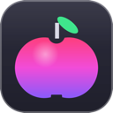

### Bonjour 👋

[English](README.md) · **Français** · [Español](README.es.md)

Je crée des logiciels **libres, gratuits et sans publicité** pour Windows, macOS et le navigateur. Aucune télémétrie. Les fonctions locales ne demandent pas de compte ; la synchronisation facultative envoie les données choisies au service configuré.

🌐 **Disponibles en 8 langues** : français, anglais, espagnol, allemand, italien, portugais, chinois et japonais. Chaque logiciel permet de choisir sa langue dans les réglages.

| | Logiciel | Pour | En bref | Langues | Installer |
|:-:|---|---|---|---|---|
|  | **[AutoDex](https://github.com/jeremdevgit/autodex)** | Windows · macOS · Linux · téléphone | Repérez, photographiez, collectionnez : jeu de collection de voitures avec reconnaissance de photos sur l'appareil. | 🌐 8 langues | [Télécharger](https://github.com/jeremdevgit/autodex/releases/tag/v0.1.0) |
|  | **[Decklight](https://github.com/jeremdevgit/decklight)** | Windows · macOS · Linux | Deck virtuel, modèles USB compatibles et import de profils Stream Deck. | 🌐 8 langues | [Télécharger](https://github.com/jeremdevgit/decklight/releases/tag/v0.2.0) |
|  | **[JMeca](https://github.com/jeremdevgit/jmeca)** | Windows · macOS · Linux | Garage chiffré : véhicules, dossiers clients, rappels, carnet d’entretien et carburant. | 🌐 8 langues | [Télécharger](https://github.com/jeremdevgit/jmeca/releases/tag/v0.1.1-beta.2) |
|  | **[Carnet de notes](https://github.com/jeremdevgit/carnet-rust)** | Windows | Notes locales chiffrées, interface inspirée de Liquid Glass et synchronisation Joplin/Nextcloud expérimentale. | 🌐 8 langues | [Télécharger le ZIP](https://github.com/jeremdevgit/carnet-rust/releases/latest) |
|  | **[Boîte à outils](https://github.com/jeremdevgit/boite-a-outils)** | Windows · macOS | Entretenir son ordinateur sans rien casser : démarrage, nettoyage, réglages cachés, matériel, capteurs, historique annulable. | 🌐 8 langues | [Télécharger](https://github.com/jeremdevgit/boite-a-outils/releases/latest) |
|  | **[Pomme](https://github.com/jeremdevgit/pomme)** | Windows | Lecteur de musique léger pour Apple Music et les fichiers audio locaux : paroles, égaliseur, mini-lecteur. | 🌐 8 langues | [Télécharger](https://github.com/jeremdevgit/pomme/releases/latest) |
|  | **[rJb](https://github.com/jeremdevgit/rjb)** | Windows | L'éclairage RGB de tous vos périphériques et composants dans une seule application légère. | 🌐 8 langues | [Télécharger](https://github.com/jeremdevgit/rjb/releases/latest) |
|  | **[LJ Hub](https://github.com/jeremdevgit/lj-hub)** | Windows · macOS · Linux | Profils locaux et inventaire Logitech ; commandes matérielles expérimentales sur les souris compatibles. Le RVB reste à rJb par défaut. | 🌐 8 langues | [Télécharger l'alpha](https://github.com/jeremdevgit/lj-hub/releases/tag/v0.1.3-alpha.1) |
|  | **[Ludothèque](https://github.com/jeremdevgit/ludotheque)** | macOS | Tous vos jeux au même endroit : Steam, Epic, GOG, Xbox, PlayStation, émulateurs… | 🌐 8 langues | [Télécharger](https://github.com/jeremdevgit/ludotheque/releases/latest) |
|  | **[Suite Libre](https://github.com/jeremdevgit/suite-libre)** | Navigateur | Six outils sans compte : QR codes, flou d'images, compression de photos, conversions, moyennes, mots de passe. | 🌐 8 langues | [Ouvrir](https://jeremdevgit.github.io/suite-libre/) |
|  | **[Batailles de France](https://github.com/jeremdevgit/batailles-de-france)** | Navigateur | Jeu de stratégie en temps réel sur les cartes de Lyon, Paris, Marseille, Bordeaux et Strasbourg. | 🌐 8 langues | [Jouer](https://github.com/jeremdevgit/batailles-de-france/releases/latest) |

Les installateurs remplacent automatiquement la version précédente lorsqu'ils sont proposés. Carnet de notes est actuellement distribué en ZIP portable. Chaque version publiée est accompagnée de son empreinte SHA-256.

Une idée, un problème ? Ouvrez un ticket dans le dépôt du logiciel concerné. Pour une faille de sécurité, utilisez le signalement privé (onglet **Security**).
