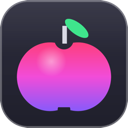

### Hi there 👋

**English** · [Français](README.fr.md) · [Español](README.es.md)

I build **free, open-source, ad-free** software for Windows, macOS and the web. No telemetry. Local features need no account; optional synchronization sends selected data to the service you choose.

🌐 **Available in 8 languages**: English, French, Spanish, German, Italian, Portuguese, Chinese and Japanese — each app lets you switch language in its settings.

| | Software | For | In short | Languages | Install |
|:-:|---|---|---|---|---|
|  | **[AutoDex](https://github.com/jeremdevgit/autodex)** | Windows · macOS · Linux · phone | Spot it, snap it, collect it: car collection game with on-device photo recognition. | 🌐 8 languages | [Download](https://github.com/jeremdevgit/autodex/releases/tag/v0.1.0) |
|  | **[Decklight](https://github.com/jeremdevgit/decklight)** | Windows · macOS · Linux | Virtual Stream Deck, supported USB models and Stream Deck profile import. | 🌐 8 languages | [Download](https://github.com/jeremdevgit/decklight/releases/tag/v0.2.0) |
|  | **[JMeca](https://github.com/jeremdevgit/jmeca)** | Windows · macOS · Linux | Encrypted vehicle maintenance, client folders, service log and fuel tracking. | 🌐 8 languages | [Download](https://github.com/jeremdevgit/jmeca/releases/tag/v0.1.1-beta.2) |
|  | **[Carnet de notes](https://github.com/jeremdevgit/carnet-rust)** | Windows | Encrypted local notes with a Liquid Glass inspired interface and Joplin/Nextcloud sync, including Joplin end-to-end encryption. | 🌐 8 languages | [Download](https://github.com/jeremdevgit/carnet-rust/releases/tag/v0.5.0) |
|  | **[Boîte à outils](https://github.com/jeremdevgit/boite-a-outils)** | Windows · macOS | Look after your computer without breaking anything: startup, cleanup, hidden settings, hardware, sensors, undoable history. | 🌐 8 languages | [Download](https://github.com/jeremdevgit/boite-a-outils/releases/latest) |
|  | **[Pomme](https://github.com/jeremdevgit/pomme)** | Windows | A lightweight music player for Apple Music and local audio files: lyrics, equalizer, mini player. | 🌐 8 languages | [Download](https://github.com/jeremdevgit/pomme/releases/latest) |
|  | **[rJb](https://github.com/jeremdevgit/rjb)** | Windows | RGB lighting for all your peripherals and components in one lightweight app. | 🌐 8 languages | [Download](https://github.com/jeremdevgit/rjb/releases/latest) |
|  | **[LJ Hub](https://github.com/jeremdevgit/lj-hub)** | Windows · macOS · Linux | Local Logitech device profiles and inventory; experimental hardware controls for supported mice. RGB stays with rJb by default. | 🌐 8 languages | [Download alpha](https://github.com/jeremdevgit/lj-hub/releases/tag/v0.2.0-alpha.1) |
|  | **[Ludothèque](https://github.com/jeremdevgit/ludotheque)** | macOS | All your games in one place: Steam, Epic, GOG, Xbox, PlayStation, emulators… | 🌐 8 languages | [Download](https://github.com/jeremdevgit/ludotheque/releases/latest) |
|  | **[Suite Libre](https://github.com/jeremdevgit/suite-libre)** | Browser | Six tools with no account: QR codes, image blurring, photo compression, conversions, grade averages, passwords. | 🌐 8 languages | [Open](https://jeremdevgit.github.io/suite-libre/) |
|  | **[Batailles de France](https://github.com/jeremdevgit/batailles-de-france)** | Browser | Real-time strategy game on the maps of Lyon, Paris, Marseille, Bordeaux and Strasbourg. | 🌐 8 languages | [Play](https://github.com/jeremdevgit/batailles-de-france/releases/latest) |

Installers replace the previous version automatically where available. Each release includes SHA-256 checksums.

An idea, a problem? Open an issue in the software's repository. For a security flaw, please use private reporting (**Security** tab).
